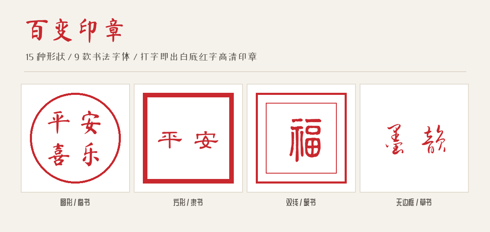

# 百变印章

一款真正傻瓜式的 Android 印章生成器：**选形状 → 选字体 → 打字 → 一键保存**。
所有印章都是纯白底、朱红字的高清 PNG，可直接用于落款、头像、手账或打印。



## 直接安装

- 下载仓库根目录的 [百变印章.apk](百变印章.apk)（约 27 MB），在 Android 手机上点击安装即可
- 要求 **Android 5.0（API 21）及以上**，无需联网、无需注册、无广告
- 首次保存到相册时，Android 9 及以下会请求一次存储权限；Android 10 及以上无需任何权限

## 三步出印

1. **输入文字**：1–12 个字，也可以直接点「懒人一键填词」里的快捷词
2. **点一个形状**：15 种模板，每个都有缩略图，所见即所得
3. **点一种字体**：9 款书体，每张卡片直接用该字体显示一个「印」字

改任意一项，中间的大图会**实时重画**。满意后点「保存到相册 / 下载图片」，
得到 1600 × 1600 的 PNG，保存在相册的「百变印章」文件夹；也可以直接分享给朋友。

> 文字按输入顺序**从左到右、从上到下**排布（不是传统印章的右起读法），
> 所以输入「张三」看到的就是「张三」，不用学读印规则。末行会自动居中，
> 字号按字数和形状自动缩放。

## 功能特点

- **15 种形状 / 边框模板**，全部由代码矢量绘制，任意分辨率都清晰
- **9 款内置字体全部离线打包**，不联网、不下载字体、不依赖系统字体
- **实时预览**，输入即出图，选中项高亮显示
- **缺字自动回退**：篆书、隶书字库覆盖有限，遇到没有字形的字自动改用楷书补上
- **导出 1600 × 1600 高清 PNG**，白底红字，无水印
- **零第三方依赖**：纯 Android 原生 API，无 AndroidX、无 SDK、无网络权限
- 命令行即可构建，不需要 Android Studio 或 Gradle

## 内置模板（15 种）

| 形状 | 边框风格 |
| --- | --- |
| 圆形 | 细边 / 双线 / 回纹 |
| 方形 | 细边 / 粗边 |
| 圆角方形 | 双线 |
| 椭圆 | 细边 |
| 长方（引首章） | 细边 · 横排文字 |
| 古玺田字格 | 细边 + 十字界格 |
| 瓦当 | 细边 + 十字 + 中心圆 |
| 葫芦形 / 心形 / 八角形 / 扇形 | 粗边或细边 |
| 无边框 | 纯文字 |

## 内置字体（9 款）

| 书体 | 字体 | 授权 |
| --- | --- | --- |
| 楷书 | 马善政楷书 | OFL 1.1 |
| 行楷 | 龙藏行楷 | OFL 1.1 |
| 行书 | 志莽行书 | OFL 1.1 |
| 草书 | 刘建毛草 | OFL 1.1 |
| 隶书 | 教育部隶书 | CC BY-ND 3.0 TW（原样分发） |
| 篆书 | 说文小篆 | OFL 1.1 |
| 宋韵 | 站酷小薇 | OFL 1.1 |
| 现代 | 庆科黄油 | OFL 1.1 |
| 趣味 | 站酷快乐 | OFL 1.1 |

字体的完整来源、授权全文与本项目做的处理（哪些做了子集化、哪些逐字节原样保留）
见 [docs/FONT_LICENSES.md](docs/FONT_LICENSES.md)。
**字体不适用 MIT 许可**，请务必按各自的授权使用。

## 从源码构建

环境要求：

- JDK 17
- Android SDK：`platforms;android-34` + `build-tools;34.0.0`（设置 `ANDROID_HOME`）
- Python 3 + `fontTools` + `Pillow`（仅重新生成字体/图片时需要）

```bash
git clone https://github.com/donghuaigu123/bai-bian-yin-zhang.git
cd bai-bian-yin-zhang

# 可选：重新下载并子集化字体（仓库已附带，通常不需要）
python3 scripts/prepare_fonts.py

# 可选：重新生成应用图标与 docs/preview.png
python3 scripts/make_assets.py

# 构建并签名 APK，产物为 ./百变印章.apk
bash scripts/build-apk.sh
```

`scripts/build-apk.sh` 直接用 `aapt2 → javac → d8 → zipalign → apksigner`
完成全部构建，不访问 Maven、不下载 Gradle 依赖。

## 项目结构

```
app/src/main/
├── AndroidManifest.xml
├── java/com/baibianyinzhang/app/
│   ├── MainActivity.java      主界面：傻瓜式交互、实时预览、保存/分享
│   ├── SealRenderer.java      印章绘制引擎（形状、边框、文字排布、缺字回退）
│   ├── SealTemplate.java      15 种模板定义
│   └── FontItem.java          字体条目
├── res/                       布局、颜色、样式、图标
└── assets/fonts/              9 款内置字体
scripts/
├── prepare_fonts.py           字体下载与合规化（子集化 / 原样复制 / 格式转换）
├── make_assets.py             生成图标与展示图
└── build-apk.sh               纯命令行构建 + 签名
docs/
├── preview.png                效果展示图
├── FONT_LICENSES.md           字体授权说明
└── licenses/                  OFL 全文与来源声明
```

## 授权

- 应用源代码：[MIT](LICENSE)
- 内置字体：各自授权，见 [docs/FONT_LICENSES.md](docs/FONT_LICENSES.md)

生成出来的印章图片归使用者所有，可自由使用。
